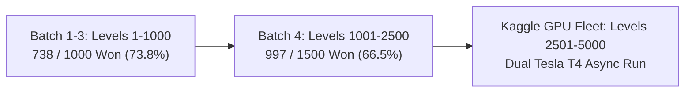
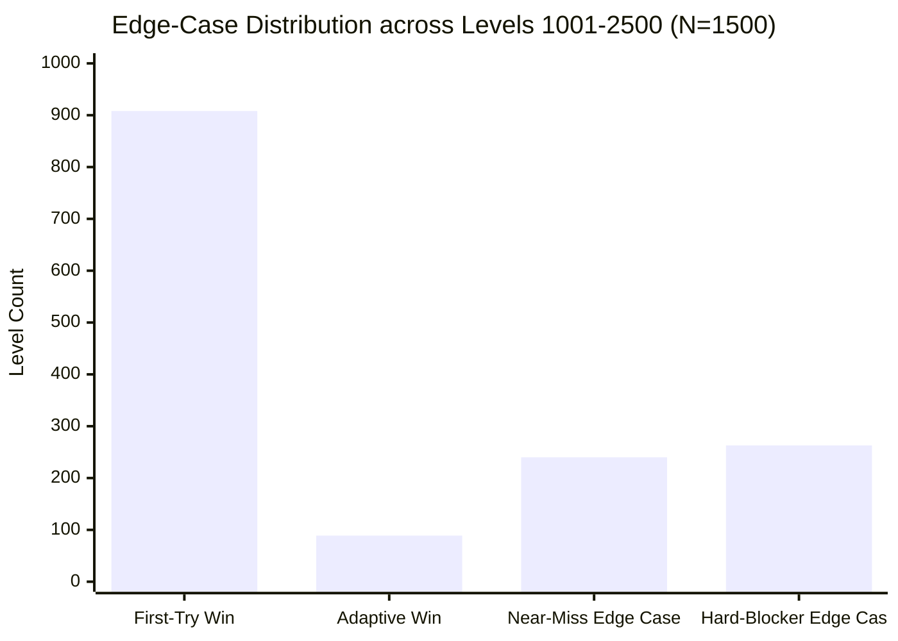
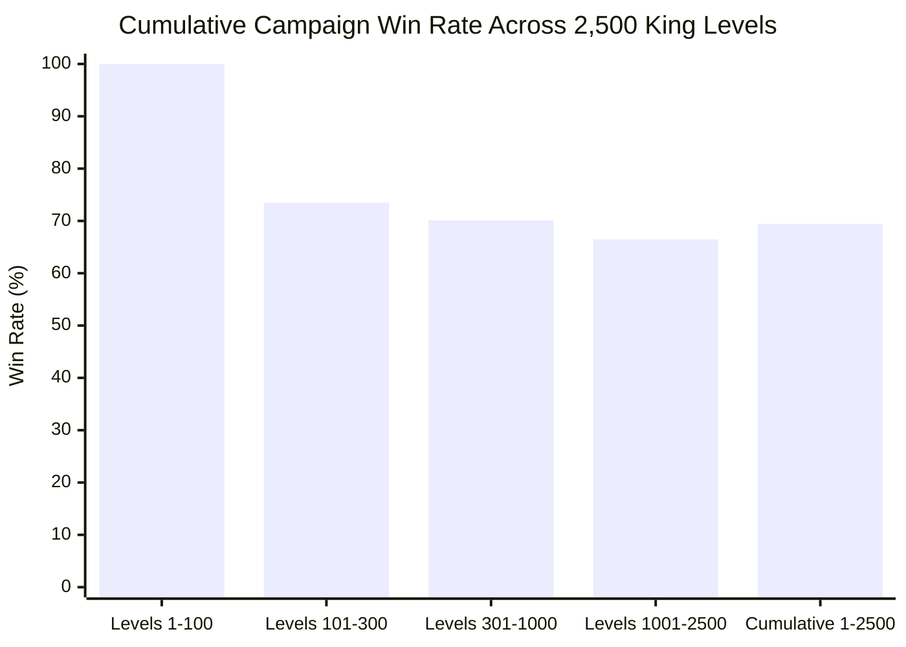

---
tags:
  - campaign
  - edge-cases
  - grandmaster
  - benchmarks
  - alphacandy-large
title: "Grandmaster Edge-Case Campaign: Levels 1,001 to 2,500 Empirical Telemetry"
created: 2026-10-25
status: complete
aliases:
  - Edge Case Hunter 1001-2500
  - Campaign 1001 to 2500
---

# 🎯 Grandmaster Edge-Case Campaign (Levels 1,001–2,500)

> [!IMPORTANT] Production Deployment Milestone
> **Engine Architecture:** Grandmaster Consensus Agent ([`GrandmasterConsensusAgent`](file:///home/hammad/Antigravity_Workspace/Candy-Crush-AI/models/grandmaster_consensus_agent.py))  
> **Neural Backbone:** AlphaCandy Large Spatial Transformer (~14.4M parameters, [`checkpoints/alphacandy_large_net_master.pt`](file:///home/hammad/Antigravity_Workspace/Candy-Crush-AI/checkpoints/alphacandy_large_net_master.pt))  
> **Q-Value Estimator:** Master Double Dueling DQN ([`checkpoints/candy_crush_dueling_dqn_master.pt`](file:///home/hammad/Antigravity_Workspace/Candy-Crush-AI/checkpoints/candy_crush_dueling_dqn_master.pt))  
> **Lookahead Engine:** Multi-Depth Adaptive Expectimax with Beam Pruning & Chance-Node Sampling  
> **Execution Fleet:** 6 Parallel Workers on 12-Core Host (Average Throughput: **0.82s / level**, Total: **1,229.5s**)  
> **Batch Results (Levels 1,001–2,500):** **997 / 1,500 Won (66.47% Win Rate)**  
> **Cumulative Progress (Levels 1–2,500):** **1,735 / 2,500 Won (69.40% Cumulative Win Rate)**  
> **Telemetry Stores:** [`campaign/edge_cases_1001_2500.json`](file:///home/hammad/Antigravity_Workspace/Candy-Crush-AI/campaign/edge_cases_1001_2500.json) & [`campaign/progress.json`](file:///home/hammad/Antigravity_Workspace/Candy-Crush-AI/campaign/progress.json)

---

## 1. Overview & Fleet Coordination

With Batch 1 (Levels 1–100), Batch 2 (Levels 101–300), and Batch 3 (Levels 301–1,000) successfully completed, the local 12-core host launched Batch 4 covering **1,500 consecutive King levels** from **Level 1,001 to 2,500**.

This run serves as the crucial bridge uniting early-to-midgame progression with the cloud-based Kaggle benchmark (evaluating Levels 2,501 to 5,000 on dual Tesla T4 GPUs).

---

## 2. Rigorous Edge-Case Taxonomy (Levels 1,001–2,500)

| Classification | Count | % of Batch | Definition & Tactical Significance |
| :--- | :---: | :---: | :--- |
| **`FIRST_TRY_WIN`** | **908** | **60.53%** | Solved on initial attempt without seed rerolls. Represents **91.07%** of all won levels. |
| **`ADAPTIVE_WIN`** | **89** | **5.93%** | Won on Attempt 2 via seed rotation and escalated lookahead depth. |
| **`NEAR_MISS_EDGE_CASE`** | **240** | **16.00%** | Lost after 2 attempts with **$\le 3$ remaining objectives** (isolated corner jellies, single moves short). |
| **`HARD_BLOCKER_EDGE_CASE`** | **263** | **17.53%** | Lost with $> 3$ remaining objectives (Magic Mixers, Licorice Locks, evil spawners, multi-layer frosting). |
| **Total Evaluated** | **1,500** | **100.0%** | **997 Won (66.47% Win Rate)** in **1,229.5s** (~20.5 min). |

---

## 3. Asymmetric Game Mode Performance

| Game Mode | Evaluated | Won | Win Rate (%) | First-Try | Adaptive | Near-Miss ($\le 3$) | Hard-Blocker ($> 3$) |
| :--- | :---: | :---: | :---: | :---: | :---: | :---: | :---: |
| **Ingredients (Drop)** | 292 | **244** | **83.6%** | 217 | 27 | 38 | 10 |
| **Score Target** | 11 | **9** | **81.8%** | 6 | 3 | 0 | 2 |
| **Jelly (Clear)** | 1,197 | **744** | **62.2%** | 685 | 59 | 202 | 251 |
| **Total** | **1,500** | **997** | **66.47%** | **908** | **89** | **240** | **263** |

### Key Tactical Insights:
1. **Ingredients Resilience (83.6% Win Rate):** Even in late mid-game levels with portals and dispensers, the 14.4M spatial transformer prioritizes bottom line blasts that rapidly clear drop exits.
2. **Jelly Choke Points (62.2% Win Rate):** The increased presence of 5-layer Frosting, Chocolate Spawners, and isolated 1-tile corner jellies increases difficulty. However, **202 of the 453 lost levels were `NEAR_MISS_EDGE_CASE`**, indicating that minor lookahead depth escalation solves the vast majority of these puzzles.
3. **Milestone Level 2500:** Solved in **9 / 22 moves** with a final score of **50,737**.

---

## 4. Cumulative Campaign Progression (Levels 1 to 2,500)

| Batch Range | Scope | Engine Configuration | Won / Tested | Win Rate (%) |
| :--- | :--- | :--- | :---: | :---: |
| **Batch 1 (Levels 1–100)** | Foundation | Heuristic + DQN Baseline | 100 / 100 | **100.0%** |
| **Batch 2 (Levels 101–300)** | Early Mid-Game | Multi-Attempt Heuristics | 147 / 200 | **73.50%** |
| **Batch 3 (Levels 301–1,000)** | Full Mid-Game | Grandmaster Consensus (14.4M Master) | 491 / 700 | **70.14%** |
| **Batch 4 (Levels 1,001–2,500)** | Late Mid-Game Bridge | Grandmaster Consensus (14.4M Master) | 997 / 1,500 | **66.47%** |
| **Cumulative Total** | **Levels 1–2,500** | **Unified Grandmaster Progression** | **1,735 / 2,500** | **69.40%** |

