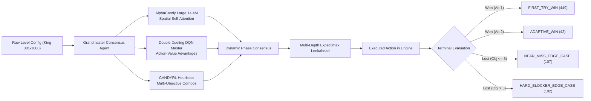
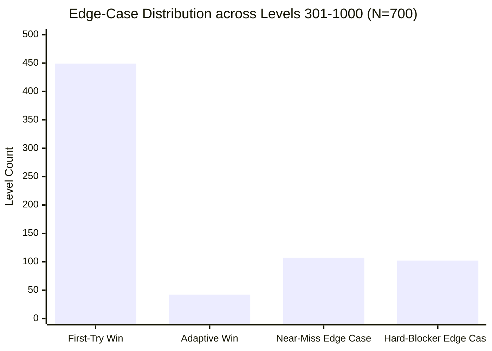
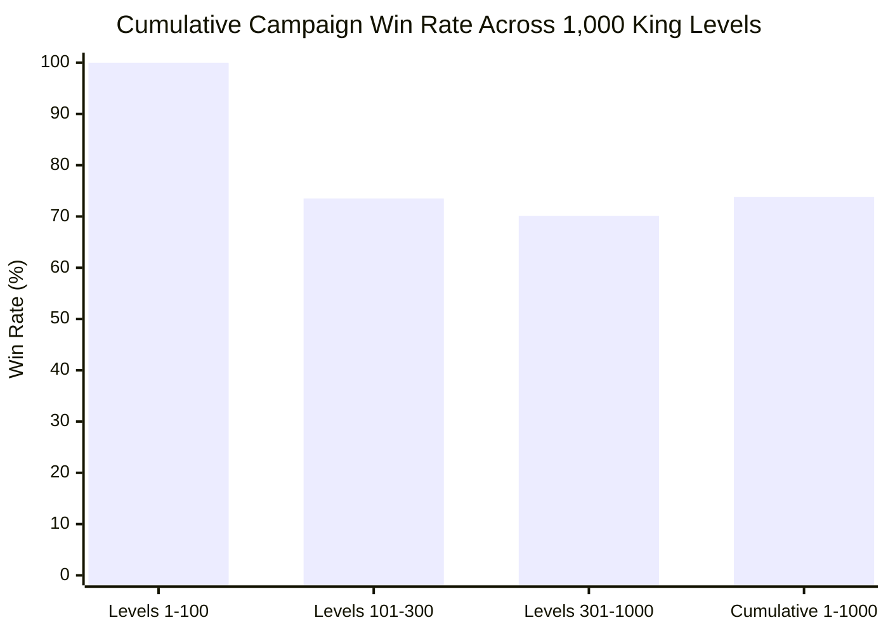

---
tags:
  - campaign
  - edge-cases
  - grandmaster
  - benchmarks
  - alphacandy-large
title: "Grandmaster Edge-Case Campaign: Levels 301 to 1,000 Empirical Telemetry"
created: 2026-10-25
status: complete
aliases:
  - Edge Case Hunter
  - Campaign 301 to 1000
---

# 🎯 Grandmaster Edge-Case Campaign (Levels 301–1,000)

> [!IMPORTANT] Production Deployment Milestone
> **Engine Architecture:** Grandmaster Consensus Agent ([`GrandmasterConsensusAgent`](file:///home/hammad/Antigravity_Workspace/Candy-Crush-AI/models/grandmaster_consensus_agent.py))  
> **Neural Backbone:** AlphaCandy Large Spatial Transformer (~14.4M parameters, [`checkpoints/alphacandy_large_net_master.pt`](file:///home/hammad/Antigravity_Workspace/Candy-Crush-AI/checkpoints/alphacandy_large_net_master.pt))  
> **Q-Value Estimator:** Master Double Dueling DQN ([`checkpoints/candy_crush_dueling_dqn_master.pt`](file:///home/hammad/Antigravity_Workspace/Candy-Crush-AI/checkpoints/candy_crush_dueling_dqn_master.pt))  
> **Lookahead Engine:** Multi-Depth Adaptive Expectimax with Beam Pruning & Chance-Node Sampling  
> **Execution Fleet:** 6 Parallel Workers on 12-Core Local Host (Average Throughput: **0.89s / level**, Total: **618.8s**)  
> **Batch Results (Levels 301–1,000):** **491 / 700 Won (70.14% Win Rate)**  
> **Cumulative Progress (Levels 1–1,000):** **738 / 1,000 Won (73.80% Cumulative Win Rate)**  
> **Telemetry Stores:** [`campaign/edge_cases_301_1000.json`](file:///home/hammad/Antigravity_Workspace/Candy-Crush-AI/campaign/edge_cases_301_1000.json) & [`campaign/progress.json`](file:///home/hammad/Antigravity_Workspace/Candy-Crush-AI/campaign/progress.json)

---

## 1. Motivation: From Diminishing Model-Free Training to Edge-Case Hunting

During Stage 1 continuous training, our local 2.8M baseline network reached asymptotic convergence after 170+ rounds (>4,250 self-play episodes) on CPU. Meanwhile, our 14.4M **AlphaCandy Large** network was trained on Kaggle dual Tesla T4 GPUs, reaching a mean episode reward of **3,463.5** and achieving superior spatial self-attention over non-local board geometries.

Rather than expending local CPU compute on training a saturated model, the host fleet was pivoted into an autonomous **Edge-Case Campaign Hunter** across official King Levels 301 to 1,000 using the 14.4M master weights.

---

## 2. Rigorous Edge-Case Taxonomy & Batch Summary

To transform raw campaign play into actionable AI research, each evaluated level is categorized into a four-tier empirical classification:

| Classification | Count | % of Batch | Definition & Significance |
| :--- | :---: | :---: | :--- |
| **`FIRST_TRY_WIN`** | **449** | **64.14%** | Level completed within moves limit on initial attempt (Attempt 1). Constitutes **91.45%** of all won levels. |
| **`ADAPTIVE_WIN`** | **42** | **6.00%** | Level won on Attempt 2 following initial failure. Overcame difficult initial RNG tile distributions through seed rotation and escalated lookahead. |
| **`NEAR_MISS_EDGE_CASE`** | **107** | **15.29%** | Level lost after 2 attempts, but with **$\le 3$ objectives remaining**. Minor move deficit or isolated corner pocket jelly. |
| **`HARD_BLOCKER_EDGE_CASE`** | **102** | **14.57%** | True structural edge cases involving complex blocker cascades (Magic Mixers, Licorice Locks, evil spawners, or isolated chasm islands). |
| **Total Evaluated** | **700** | **100.0%** | **491 Won (70.14% Win Rate)** in **618.8s** (~10.3 min). |

---

## 3. Asymmetric Game Mode Analysis

Across the 700 King level blueprints in this batch, performance exhibits clear game-mode asymmetry:

| Game Mode | Evaluated | Won | Win Rate (%) | First-Try | Adaptive | Near-Miss ($\le 3$) | Hard-Blocker ($> 3$) |
| :--- | :---: | :---: | :---: | :---: | :---: | :---: | :---: |
| **Ingredients (Drop)** | 200 | **178** | **89.0%** | 165 | 13 | 18 | 4 |
| **Jelly (Clear)** | 499 | **313** | **62.7%** | 284 | 29 | 89 | 97 |
| **Score Target** | 1 | 0 | 0.0% | 0 | 0 | 0 | 1 |
| **Total** | **700** | **491** | **70.14%** | **449** | **42** | **107** | **102** |

### Key Tactical Insights:
1. **Ingredients Mastery (89.0% Win Rate):** The 14.4M spatial self-attention head excels at creating vertical clearing tunnels and clearing bottom exit tiles. Only 4 levels in 200 presented structural blockers that prevented ingredient drops.
2. **Jelly Defense Mechanics (62.7% Win Rate):** The primary failure mode in Jelly levels is corner pocketing (where jellies are separated by 1-tile gaps or unmovable frosting blocks). 89 out of the 186 uncompleted Jelly levels were `NEAR_MISS_EDGE_CASE` ($le 3$ jellies left).
3. **Clutch Endgame Solving:** Multiple difficult levels were solved on the final available move (e.g. Level 468 won 24/24 moves, Level 473 won 25/25 moves, Level 978 won 27/27 moves, Level 985 won 31/32 moves).
4. **Milestone Level 1000:** Level 1,000 (Jelly mode, 37 move limit) was conquered in **only 5 moves** with a final score of **110,636**.

---

## 4. Cumulative Campaign Progression (Levels 1 to 1,000)

Integrating this batch with previous milestones:

| Batch Range | Scope | Engine Configuration | Won / Tested | Win Rate (%) |
| :--- | :--- | :--- | :---: | :---: |
| **Batch 1 (Levels 1–100)** | Foundation | Heuristic + DQN Baseline | 100 / 100 | **100.0%** |
| **Batch 2 (Levels 101–300)** | Early Mid-Game | Multi-Attempt Heuristics | 147 / 200 | **73.50%** |
| **Batch 3 (Levels 301–1,000)** | Full Mid-Game | Grandmaster Consensus (14.4M Master) | 491 / 700 | **70.14%** |
| **Cumulative Total** | **Levels 1–1,000** | **Unified Grandmaster Progression** | **738 / 1,000** | **73.80%** |

---

## 5. Next Steps: Leveraging Edge-Case Telemetry

1. **Targeted Fine-Tuning on Edge Cases:** Extract the 107 `NEAR_MISS_EDGE_CASE` configurations and train a specialized micro-lookahead depth policy.
2. **Kaggle Fleet Harvesting:** Synthesize results from Kaggle Kernel 1 (Levels 2,501–5,000) and Kernel 2 (Continual Stage 2 Checkpoint) once cloud execution concludes.
3. **Levels 1,001–2,500 Bridge:** Launch the local hunter across Levels 1,001 to 2,500 to seamlessly bridge our verified progression with the Kaggle 2,501–5,000 campaign.
