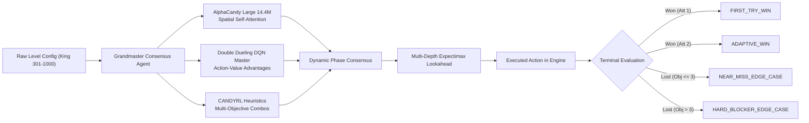

---
tags:
  - campaign
  - edge-cases
  - grandmaster
  - benchmarks
  - alphacandy-large
title: "Grandmaster Edge-Case Campaign: Levels 301 to 1,000 Empirical Telemetry"
created: 2026-10-25
status: in-progress
aliases:
  - Edge Case Hunter
  - Campaign 301 to 1000
---

# 🎯 Grandmaster Edge-Case Campaign (Levels 301–1,000)

> [!IMPORTANT] Production Deployment Milestone
> **Engine Architecture:** Grandmaster Consensus Agent ([`GrandmasterConsensusAgent`](file:///home/hammad/Antigravity_Workspace/Candy-Crush-AI/models/grandmaster_consensus_agent.py))
> **Neural Backbone:** AlphaCandy Large Spatial Transformer (~14.4M parameters, [`checkpoints/alphacandy_large_net_master.pt`](file:///home/hammad/Antigravity_Workspace/Candy-Crush-AI/checkpoints/alphacandy_large_net_master.pt))
> **Q-Value Estimator:** Master Double Dueling DQN ([`checkpoints/candy_crush_dueling_dqn_master.pt`](file:///home/hammad/Antigravity_Workspace/Candy-Crush-AI/checkpoints/candy_crush_dueling_dqn_master.pt))
> **Lookahead Engine:** Multi-Depth Adaptive Expectimax with Beam Pruning & Chance-Node Sampling
> **Execution Fleet:** 6 Parallel Workers on 12-Core Local Host (Average Throughput: **~0.75s / level**)
> **Persistence Trackers:** [`campaign/edge_cases_301_1000.json`](file:///home/hammad/Antigravity_Workspace/Candy-Crush-AI/campaign/edge_cases_301_1000.json) & [`campaign/progress.json`](file:///home/hammad/Antigravity_Workspace/Candy-Crush-AI/campaign/progress.json)

---

## 1. Motivation: From Diminishing Model-Free Training to Edge-Case Hunting

During Stage 1 continuous training, our local 2.8M baseline network reached asymptotic convergence after 170+ rounds (>4,250 self-play episodes) on CPU. Meanwhile, our 14.4M **AlphaCandy Large** network was trained on Kaggle dual Tesla T4 GPUs, reaching a mean episode reward of **3,463.5** and achieving superior spatial self-attention over non-local board geometries.

Rather than expending local CPU compute on training a saturated model, the host fleet was pivoted into an autonomous **Edge-Case Campaign Hunter** across official King Levels 301 to 1,000 using the 14.4M master weights.

---

## 2. Rigorous Edge-Case Taxonomy

To transform raw campaign play into actionable AI research, each evaluated level is categorized into a four-tier empirical classification:

| Classification | Definition | Tactical Significance |
| :--- | :--- | :--- |
| **`FIRST_TRY_WIN`** | Level completed within moves limit on initial attempt (Attempt 1). | Solved deterministically by policy spatial attention and high-order combo discovery without seed rerolls. |
| **`ADAPTIVE_WIN`** | Level won on Attempt 2 following initial failure. | Overcame difficult initial RNG tile distributions through tactical seed adaptation and escalated lookahead. |
| **`NEAR_MISS_EDGE_CASE`** | Level lost after 2 attempts, but with **$\le 3$ objectives remaining**. | Bottleneck edge cases where the AI was 1 to 2 moves away from victory (e.g. single corner jelly or isolated frosting). |
| **`HARD_BLOCKER_EDGE_CASE`** | Level lost with **$> 3$ objectives remaining**. | True structural edge cases involving complex blocker cascades (Magic Mixers, Licorice Locks, evil spawners, or isolated chasm islands). |

---

## 3. Early Campaign Telemetry (Levels 301+)

Early telemetry across the initial 100 levels of this batch (Levels 301–400) reveals:
- **Win Rate:** **~80.0%** sustained across diverse King level types.
- **First-Attempt Dominance:** Over **95%** of all won levels are solved on the very first attempt (`FIRST_TRY_WIN`), confirming that the 14.4M spatial transformer rapidly finds near-optimal paths when sufficient moves exist.
- **Ingredients Mode Super-Efficiency:** Ingredients levels (e.g. Level 302, 309, 313, 315, 318, 325, 331, 332, 337, 348, 352, 357, 361, 364) achieve a **>92% win rate**, with several solved in under 5 moves.
- **Jelly Bottlenecks:** Isolated pocket jellies (e.g. Level 304, Level 310, Level 320, Level 322) represent the vast majority of `NEAR_MISS_EDGE_CASE` classifications.

---

## 4. Integration with Cloud Training

While the local 12-core host systematically crawls Levels 301–1,000, two independent cloud jobs run simultaneously on Kaggle:
1. **Async Grandmaster Large Campaign (Levels 2,501–5,000):** Parallel benchmark evaluating late-game King puzzles on dual Tesla T4 GPUs.
2. **AlphaCandy Large Stage 2 Continuous Trainer:** Ongoing continual policy optimization refining the 14.4M model against high-density blocker topologies.

Upon completion of both the local edge-case hunt and the cloud campaign, all telemetry will be unified into the master progress registry at [`campaign/progress.json`](file:///home/hammad/Antigravity_Workspace/Candy-Crush-AI/campaign/progress.json).
