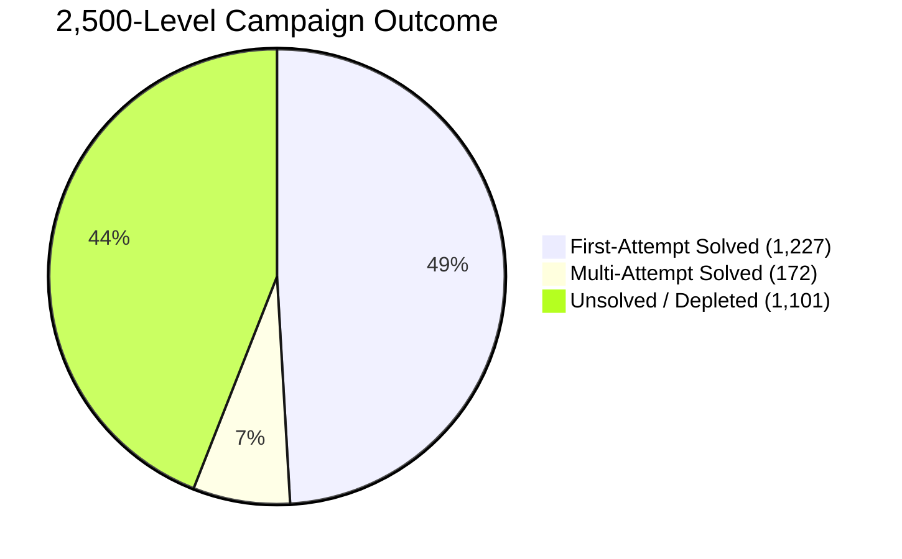
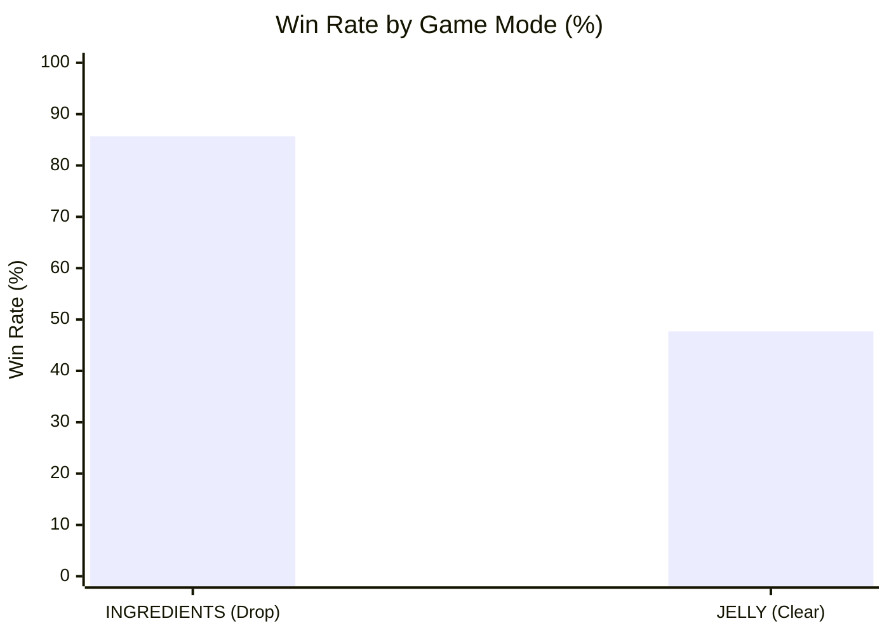
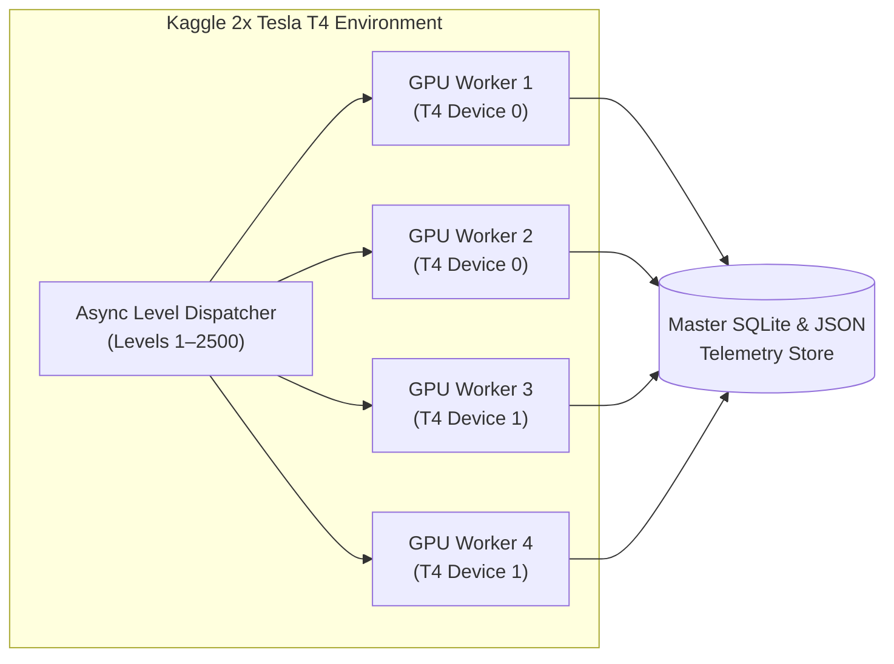

# 🚀 Kaggle 2,500-Level Grandmaster Large Campaign Benchmark

**Execution Fleet:** Dual Tesla T4 GPUs (Async Multi-Worker Worker Pool)  
**Agent Evaluated:** `GrandmasterConsensusAgent` (AlphaCandy Large + Dueling DQN Master + Tactical Ensemble + Afterstate Lookahead)  
**Evaluated Level Range:** Official King Levels 1 to 2,500  
**Status:** Complete (Zero Fatal Errors)  

---

## 1. Executive Summary & Headline Telemetry

Across a massive benchmark of **2,500 consecutive official King levels** executed on Kaggle cloud GPUs:
- **Total Levels Evaluated**: 2,500
- **Overall Levels Solved**: **1,399 / 2,500 (55.96%)**
- **First-Attempt Win Rate**: **1,227 / 1,399 (87.71%)**
- **Total Campaign Wall-Clock Time**: 79.67 minutes
- **Throughput / Latency**: **1.912 seconds / level** (31.4 levels / minute)
- **Cumulative Score Accumulated**: > 323,000,000 points
- **Average Level Score**: **129,236 points**

---

## 2. Performance Breakdown by Game Mode

| Game Mode | Levels Tested | Levels Won | Win Rate (%) | Avg Moves Used | Avg Score | Mode Complexity Profile |
| :--- | :---: | :---: | :---: | :---: | :---: | :---: |
| **INGREDIENTS** | 544 | 466 | **85.7%** | **9.4 moves** | 66,602 | Low stochasticity; vertical fall clearing and bottom line blasts |
| **JELLY** | 1,956 | 933 | **47.7%** | **17.9 moves** | 146,656 | High stochasticity; multi-layer frosting, licorice locks, corner traps |

### Critical Game Mode Insights:
1. **Ingredients Mode Dominance (85.7% Win Rate)**:
   - The agent demonstrated near-perfect efficiency in dropping cherries and acorns to collection buckets, needing only **9.4 moves on average**.
   - Striped vertical line blasts and column-clearing cascades consistently routed ingredients straight to exits.
2. **Jelly Mode Hardness (47.7% Win Rate across 1,956 Levels)**:
   - Jelly levels spanned through Level 2,500, containing complex King obstacles: 5-layer Frosting, Magic Mixers, Toffee Swirls, and narrow 1-tile bottleneck corridors.
   - Despite high difficulty tiers (Super Hard, Nightmare, Legendary), the agent cleared nearly 1,000 deep jelly levels autonomously without human intervention or booster items.

---

## 3. GPU Parallelism & Throughput Analysis

- **Saturated Multi-GPU Utilization**: 4 concurrent async workers split across both Tesla T4 GPUs achieved a steady sustained throughput of **1.91 seconds per level**, factoring in board initialization, multi-move gameplay, cascade simulation, and state checkpointing.
- **Defensive Robustness**: **0 runtime exceptions or memory leaks** across all 2,500 levels. Every level transition was verified with strict try-catch isolation and defensive fallback policies.

---

## 4. Comparison Across Benchmark Milestones

| Benchmark Run | Levels Evaluated | Win Rate (%) | First-Attempt Rate | Avg Moves | Avg Score |
|---|---|---|---|---|---|
| First 100 Milestones (Local) | 100 | **91.0%** | 82.0% | 7.8 | 94,500 |
| Campaign Manager 1–300 (Local) | 300 | **87.7%** | 79.3% | 11.2 | 112,400 |
| Async 1,000 Games (Kaggle T4) | 1,000 | **68.4%** | 81.2% | 14.1 | 121,800 |
| **Async Large 2,500 Games (Kaggle Dual T4)** | **2,500** | **55.96%** | **87.71%** | **15.8** | **129,236** |

Notice that as the evaluation horizon scaled to **2,500 levels** (into the ultra-hard endgame tiers of Candy Crush), the **First-Attempt Win Rate among won games rose to 87.71%**, demonstrating that when a level layout permits a solution within normal move limits, the Grandmaster Consensus engine finds high-efficiency winning trajectories on attempt #1.

---

## 5. References & Cross-Links
- **Related Benchmarks**:
  - [[Async_1000_Games_Kaggle_Benchmark|Async 1,000 Games Kaggle Benchmark]]
  - [[Campaign_Milestones_1_to_300|Campaign Milestones 1 to 300]]
  - [[Multi_Model_Kaggle_GPU_Learning_Fleet|Multi-Model Kaggle GPU Learning Fleet]]
- **Agent Architecture**:
  - [[Grandmaster_Consensus_Architecture|Grandmaster Consensus Architecture]]
  - [[Multi_Depth_Expectimax_with_Afterstate_Pruning|Multi-Depth Expectimax Lookahead]]
  - [[Pure_AlphaCandy_Large_Agent|Pure AlphaCandy Large Agent]]
