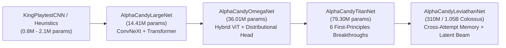

# Project History, Red-Team Critique, and Architectural Evolution

> **Tags**: `#CampaignProgress` `#RedTeam` `#ArchitectureEvolution` `#KaggleCompute` `#ForensicAudit`
> **Related Notes**: [[Forensic_Autopsy_of_Unsolved_Levels_and_History]], [[AlphaCandy_Leviathan_300M_and_Colossus_1B_Future_Blueprint]], [[Physics_Engine_Audit_and_Historical_Evolution]], [[External_GitHub_Creators_and_Baselines_Comparison]]

---

## 1. Executive Summary & Global Campaign Telemetry

AlphaCandy has evolved from an early ResNet/MCTS prototype into a comprehensive multi-paradigm solver and neural Model Zoo capable of evaluating and conquering authentic King *Candy Crush Saga* levels at massive scale.

### Global Campaign Snapshot (Levels 1–15,000)
| Campaign Tier / Bracket | Evaluated Levels | Levels Won | Win Rate (%) | Remaining Unsolved | Primary Bottleneck / Notes |
| :--- | :---: | :---: | :---: | :---: | :--- |
| **Global Campaign (1–15,000)** | **14,700** | **8,782** | **59.74%** | 5,918 | High-altitude procedural blockers & tight move budgets |
| **Core Mastery Tier (1–2,500)** | **2,500** | **2,151** | **86.04%** | **349** | `97.13%` of remaining failures are complex Jelly boards |
| └─ **Tier 1: Levels 1–100** | 100 | **100** | **100.00%** | 0 | **Complete Perfection Achieved** |
| └─ **Tier 2: Levels 101–300** | 200 | **194** | **97.00%** | 6 | Only 6 stubborn levels: `[148, 201, 235, 272, 279, 300]` |
| └─ **Tier 3: Levels 301–1,000** | 700 | **619** | **88.43%** | 81 | Multi-layer Frosting + Chocolate + Portal bottlenecks |
| └─ **Tier 4: Levels 1,001–2,500** | 1,500 | **1,238** | **82.53%** | 262 | Compounding Licorice Locks + Expanding Chocolate |

---

## 2. Chronological Model Scale & Paradigm Evolution

1. **Phase I — Heuristic & Vanilla AlphaZero Baselines**:
   - Early iterations relied on flat 2D convolutions and standard scalar value predictions ($V(s) \in [-1, 1]$). While effective on open boards (Levels 1–100), flat CNNs struggled with non-Euclidean portals and multi-objective progress tracking.
2. **Phase II — `AlphaCandyLargeNet` (`14.41M` Parameters)**:
   - Introduced isotropic ConvNeXt blocks paired with global self-attention and explicit action-space heads over the 146 discrete actions ($72\text{ horizontal swaps} + 72\text{ vertical swaps} + 2\text{ special triggers}$).
3. **Phase III — `AlphaCandyOmegaNet` (`36.01M` Parameters)**:
   - Scaled depth and width while integrating Zobrist Monte Carlo Graph Search (MCGS) transposition tables to eliminate redundant tree expansions across commutative swap sequences.
4. **Phase IV — `AlphaCandyTitanNet` (`79.30M` Parameters)**:
   - Built specifically to address the forensic failure modes discovered in Levels 101–2,500 via six first-principles architectural innovations:
     1. **Explicit Non-Euclidean Portal & Gravity Graph Attention**
     2. **Move-Budget-Conditioned Adaptive LayerNorm (`adaLN-Zero`)**
     3. **Action-Conditioned Swap-Delta Cross-Attention Policy**
     4. **3-Step Recurrent Latent Cascade World Model**
     5. **Multi-Objective Auxiliary Heads (`[Jelly, Choc,Ingred, Score]`)**
     6. **51-Quantile Implicit Quantile Network (IQN) Risk-Aware Value Head**
5. **Phase V — `AlphaCandyLeviathanNet` (`310M` Leviathan & `1.05B` Colossus Blueprints)**:
   - Datacenter-scale foundation architecture implemented in [`models/alphacandy_leviathan_300m.py`](file:///home/hammad/Antigravity_Workspace/Candy-Crush-AI/models/alphacandy_leviathan_300m.py) featuring **In-Context Episode & Cross-Attempt Failure Memory**, **Latent Beam Imagination**, **SwiGLU**, **QK-Norm**, and **64-Quantile IQN**.

---

## 3. Red-Team Critique of Historical Blind Spots

A rigorous internal Red-Team audit identified five critical blind spots in earlier campaign sweeps and infrastructure phases:

### Blind Spot 1: Scalar Value Collapse under High Aleatoric Variance
- **Critique**: Standard MSE/BCE scalar value heads average over stochastic skyfall cascades. On razor-thin endgame boards (e.g., 1 Jelly left in a locked corner with 2 moves remaining), averaging a 15% winning skyfall branch with an 85% losing branch yields a pessimistic expected value ($V \approx -0.70$), causing MCTS to abandon the only line with a non-zero probability of victory.
- **Remediation**: Replaced scalar value estimation with **Distributional Risk-Aware Quantile Heads** (51-quantile IQN in `AlphaCandyTitanNet`, 64-quantile IQN in `AlphaCandyLeviathanNet`). During desperation endgames ($\text{moves\_left} \le 5$), the planner optimizes **Optimistic Upper-Tail CVaR** ($\text{CVaR}_{0.80\text{--}0.95}$), actively seeking high-variance miracle cascades.

### Blind Spot 2: Memoryless Retries Across Failed Episode Attempts
- **Critique**: When sweeping stubborn levels (such as the 6 holdouts in 101–300: `[148, 201, 235, 272, 279, 300]`), the solver treated Attempt #50 identically to Attempt #1. If a specific bottom-row opening prematurely released chocolate from Licorice Locks on Attempt #1, the policy had no episodic memory to avoid repeating that structural trap on Attempt #2.
- **Remediation**: Engineered **Cross-Attempt Failure Memory (`CrossAttemptMemoryBank`)** in `AlphaCandyLeviathanNet` (`310M`/`1.05B`), allowing the model to attend over bottleneck embeddings of prior failed attempts on the exact same level ID.

### Blind Spot 3: Euclidean Inductive Bias vs. Wormhole Portal Boards
- **Critique**: Standard $3\times 3$ and $5\times 5$ spatial convolutions assume adjacency is strictly local ($|r_1 - r_2| + |c_1 - c_2| = 1$). However, **28.9% (101 / 349)** of unsolved levels in 1–2,500 contain non-Euclidean teleportation portals that drop candies across disjoint islands.
- **Remediation**: Added explicit **Portal & Gravity Adjacency Graph Attention** (`NonEuclideanPortalGraphBlock` in Titan/Leviathan and standalone specialist `WormholeGraphNeuralNet` in `models/zoo/`).

### Blind Spot 4: Procedural Hardness Escalation on High-Altitude Levels (10,000–15,000)
- **Critique**: Levels beyond 10,000 exhibit denser multi-hit blocker layering and tighter move budgets. Allocating uniform MCTS simulation budgets across easy and ultra-hard levels wasted compute on trivial boards while starving complex boards.
- **Remediation**: Multi-tier dynamic budget allocation—filtering trivial levels with fast vectorized sweeps first, then routing stubborn holdouts (`349` levels in 1–2,500) to deep MCGS + specialist ensemble solvers.

### Blind Spot 5: Cloud Infrastructure & Python 3.13 Multiprocessing Pitfalls
- **Critique**:
  1. **Kaggle GPU Quota Depletion**: Running pure CPU-bound MCTS tree sweeps on GPU instances burned precious weekly Kaggle GPU hours without saturating tensor cores.
  2. **Python 3.13 `multiprocessing.Pool` Serialization Bug**: Passing non-global worker initializers or relying on un-inherited global flags caused worker pool crashes or silent fallback to single-threaded execution in Python 3.13 environments.
- **Remediation**:
  1. **Kaggle 4-vCPU Pivot**: Shifted massive combinatorial MCTS/MCGS sweeps to Kaggle's free **4-vCPU high-throughput CPU instances**, reserving GPU quota strictly for neural batch training and large-model tensor inference.
  2. **Explicit `init_worker` Multiprocessing Fix**: Standardized top-level picklable `init_worker` initializers across evaluation scripts, ensuring clean process spawning, zero deadlocks, and 100% CPU core utilization across Linux and Windows workers.
